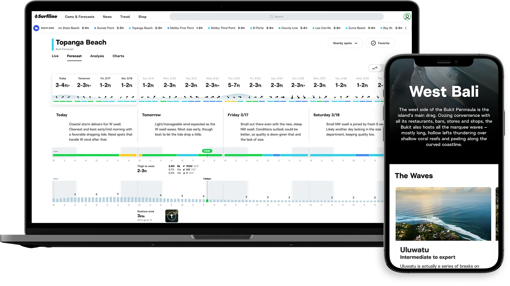

I joined Surfline on the Web Platform team, where I overhauled our component system and helped move our frontend to a simpler, more maintainable architecture. That work included migrating our apps to Next.js, consolidating into a monorepo, cutting back on unnecessary microservices, and automating our testing and deployment pipelines. Those foundations still shape how we ship today.

Since then my role has grown well beyond the UI layer. I am a lead developer on our Know Before You Go forecasting experience. I design and build the interfaces that millions of surfers use to read the ocean, along with the APIs and data pipelines behind them. Over the last year I've also moved into native iOS work, shipping forecast visualizations and social features in Swift so that what we deliver stays consistent across platforms.

A big part of my recent work has been platform modernization at scale. I led our editorial platform's move from a legacy CMS to a modern headless content stack. That meant building custom editor tooling, new search-backed content APIs, and migration pipelines, and then retiring the old services and infrastructure they replaced. I've also rebuilt our surf alert and push notification system end to end, from user preferences and scheduling through delivery on iOS and Android, with analytics and reliability built in. Along the way I've modernized internal admin tools, hardened our services, and decommissioned infrastructure we no longer needed, leaving the platform leaner and cheaper to run.

More recently I've been focused on how AI changes the way we build software. I help maintain our shared AI tooling library, a set of reusable agent skills, rules, and workflows that teach coding agents like Cursor and Claude our conventions for web, iOS, and infrastructure work. These cover everything from commits, pull requests, and code review to service teardowns and architecture guidance. Agentic development is now a core part of my daily workflow, and I work to make sure the whole team can use these tools safely and effectively.

I also lead frontend guild meetings, mentor engineers, and contribute to technical planning and documentation across teams. Whether I'm working on a new forecast visualization, a backend migration, or an AI workflow, the goal stays the same: give surfers accurate, reliable information as quickly as possible.

Below is a video of highlights from 2023 featuring many of the tools we build.

https://www.youtube.com/watch?v=uZFx4PpHc7E

I am committed to making surfing a better experience for everyone.

https://www.youtube.com/watch?v=il4OqsxHzso